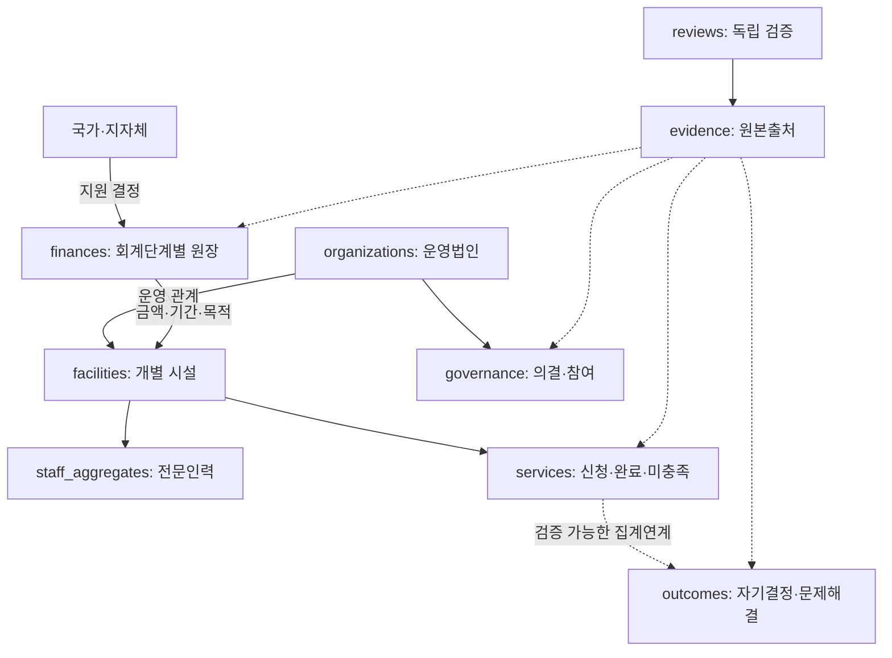

# GARD Deaf Public Accountability OS™ — 구현 설계도 v1.0

**기준일:** 2026-11-13  
**상태:** 구현 준비용 설계·데이터 규격. 실제 206개 시설의 자료 수집 또는 서비스 운영 검증 완료를 의미하지 않는다.  
**원칙:** From Community to Society → Person-Governed, Evidence-Verified Public Service  
**배포:** 오너용 독립 로컬 웹앱 A, 공개 검증용 읽기전용 웹앱 B, 별도 선택적 개인 원장 C.

---

## 0. 제품 비전과 성공 조건

### 해결할 문제
현행 공공재정의 예산서·결산서, 시설의 사업실적, 당사자의 실제 생활변화가 서로 다른 서식과 기관에 흩어져 있다. 법인 보조금과 수어통역센터 시설회계, 인력배치와 실제 서비스, 서비스 건수와 개인의 자기결정 성과를 섞지 않고 한눈에 추적해야 한다.

### 서비스의 최종 질문
> 어떤 권리주체에게 어떤 도움이 필요했으며, 누가 재정을 결정·집행하고, 어떤 서비스를 제공했으며, 당사자에게 어떤 검증 가능한 결과가 발생했는가?

### 제품 3종
1. **A — Owner Ledger / 독립형 오너 원장:** 정부·지자체·법인·센터·자료의 출처, 회계·인력·서비스·집계성과를 로컬에 관리. 수동 가져오기/검증/보관/공개 승인.
2. **B — Public Reviewer / 검증 뷰어:** 승인된 비식별·집계 JSON만 가져와 독립 계산, 필터·추적, 문제·근거 누락 지적. 오너 데이터에 쓰기 권한 없음.
3. **C — Personal Outcome Vault / 선택적 별도 제품:** 개인이 자신의 자기결정·서비스 경험·증빙·권리를 직접 관리. 초기 범위에서 제외. 기관 원장과의 개인별 자동 결합 금지.

### 성공 기준
- 1개의 합성 ZIP 또는 JSON으로 3개 가상 시설을 로드해 오류 없이 화면 표시
- 센터 명부 → 운영법인 → 회계연도별 예산/지급/집행 → 전문인력 → 서비스 → 응답자 성과 → 원본 근거까지 클릭 추적 가능
- 금액 합계는 동일 회계단계끼리만 집계; 예산과 실제 집행을 더하지 않음
- 실제 값 0과 미확인(null)을 구별
- 출처와 시점이 다른 수치를 단일 2026년 실적으로 섞지 않음
- 개인정보는 기본 데이터 모델 및 공개 산출물에 존재하지 않음
- 실제 사용자의 자기결정, 만족, 고용 및 수익을 무증빙으로 추정하지 않음
- 공개용 독립 파일은 원본과 분리되어 자체적으로 계산·검증 가능
- 100% 오프라인 사용 시 외부 API·CDN·클라우드 계정 로그인 요구 없음

## 1. 사업·법률 경계

### 적용 영역
- 「한국수화언어법」의 언어권 및 수어통역 지원
- 「장애인복지법」 및 보건복지부 「2026 장애인복지시설 사업안내」 중 지역·중앙 수어통역센터
- 「보조금 관리에 관한 법률」, 「지방자치단체 보조금 관리에 관한 법률」 등 해당 재정 원칙
- 「개인정보 보호법」 및 가명정보 처리·결합 제한
- 방송·교육·고용·보험급여 등은 별도 `program_type`으로 추후 확장

### 주의 사항
- **법인 설립허가 ≠ 시설 운영권 ≠ 보조금 교부결정 ≠ 공공서비스 최종 권리주체.**
- 국고보조금, 지방보조금, 지방이양사업 자체 지방운영비, 위탁용역비, 보험급여, 법인의 고유재원은 서로 다른 원장 및 계정에 등록한다.
- 2026.3 발표의 **206개소**와 보건복지부 현재 공개 정책페이지의 **약 208개소**는 같은 시점·동일 집계기준이라고 확인되지 않았다. **시설 수는 하드코딩 금지.** `source_date`, `as_of_date`, `facility_type`, `operating_status`, `count_definition`을 보존하고 데이터 불일치 경고를 표시한다.
- 당사자의 법률상 권리와 법인 회원의 총회·투표 권리는 다르다. `member_eligible_voters`를 전체 농인 수의 분모로 사용하지 않는다.
- 본 앱은 행정 보조금 시스템(e나라도움·보탬e)의 대체가 아니라 공개 가능한 자료에 기반한 **독립적인 분석 원장**이다.
- 2026년 지침 개정과 정산·감사·형사판단을 동일한 확정 상태로 표시하지 않는다.

## 2. 사용자와 권한

| 역할 | 실제 권한 | 불가한 행위 |
|---|---|---|
| Owner / 원장 관리자 | 자료 등록·정정·버전·비공개 보존·공개 승인 | 법적 권한 없는 타 기관 자료의 진위 확정 |
| Data Steward / 자료 입력자 | 승인된 기관 자료 입력·검증 요청 | 공개 승인 및 기존 증거 삭제 |
| Independent Reviewer / 외부 검증자 | 읽기·근거 확인·계산 재현·검증 의견 첨부 | 원본 무단 수정, 개인정보 요구 |
| Public Citizen / 공개 열람자 | 승인 데이터 필터·비교·내보내기 | 비공개 원본 열람 |
| Deaf Participant / 개인 참여자 | 별도 C 원장에서 본인 기록·동의·공유범위 관리 | 타인의 기록 보기 |
| Government/Facility / 자료제공 주체 | 공개자료·적법하게 제공된 집계표 제공 | 사용자 개인 기록 무단 결합 |

### 권한 분리
오너 앱 A와 리뷰어 앱 B는 서로 다른 HTML/JSON 패키지. 동일 인증체계가 없더라도 물리적으로 분리된 파일과 내보내기 화이트리스트로 접근을 차단한다. 로컬 웹앱의 UI 잠금만으로 강력한 접근통제나 암호화를 주장하지 않는다.

## 3. 정보 구조 / 화면 와이어프레임

**A 오너 앱 10개 화면**
1. **Start / 전체현황:** 기준일, 집계대상 시설 수, 검증자료 수, 공개가능 비율, 불일치·누락 수. 미확인 숫자는 `—`로 표시.
2. **Facility Registry / 시설 원장:** 검색(지역, 설치·운영유형, 운영주체, 기준일), 신규 등록·합병·폐쇄 이력, 중복 후보.
3. **Organization Registry / 법인 원장:** 독립 법인 ID, 법적 형태, 운영하는 센터의 관계, 운영 기간. 법인 회계와 시설 회계 분리.
4. **Funding Flows / 재정:** 회계연도·사업·자금흐름 ID, 예산/교부결정/지급/지출/정산 단계, 정부/지방/사업/고유재원, 두 단계 중복합산 금지.
5. **Workforce / 전문인력:** 수어통역사·청각장애인통역사·기타·FTE, 정원/현원, 기준일.
6. **Service Events / 서비스:** 신청·완료·미충족·이용자취소·미종결(대기), 수행 건수·실인원 별도.
7. **Person Outcomes / 집계성과:** 의사소통 이해, 자기결정, 문제 해결, 사회참여; 응답자 수·응답률·연구설계·한계.
8. **Governance / 자치·민주:** 총회 의결권자·투표자, 감사·민원 처리, 근거문서, 사건을 사실과 주장으로 구별.
9. **Evidence Lab / 출처·검증:** 원본파일 SHA-256(가능할 때), 출처기관, 문서일, 공개범위, 2인 검증, 누락/모순/수정이력.
10. **Publish & Export / 공개 승인:** 공개 화이트리스트 검사, 소표본 감춤, 합성데이터 차단, 비공개 원본 배제, JSON 다운로드.

**B 리뷰어 앱 6개 화면**
1. 공개원장 불러오기
2. 지역별·기간별 현황 대시보드
3. 센터 상세 → 법인과 재정·실적
4. 분모·기간·방법이 보이는 성과지표 계산식
5. 원문 근거·검증상태·이견 기록
6. 재현 보고서 PDF가 아닌 **HTML 인쇄/JSON** 내보내기 (기본 기능은 브라우저 인쇄)

**C 개인 원장(후속 사업)**
- 본인만의 서비스 요청·이해도·자기결정 기록
- 이용자의 선택적 동의와 범위별 권한 관리
- 기관과 연결해야 한다면 적법한 별도 절차·승인 필요
- 본인 기록을 취합하는 과정에서 다른 당사자의 정보는 수집하지 않음

### 공통 레이아웃
상단: `GARD DPA | 데이터 기준일 | 합성/실제 표시 | 로컬 저장상태 | 공개범위`  
좌측: `현황 / 시설 / 법인 / 재정 / 인력 / 서비스 / 성과 / 자치 / 증거 / 내보내기`  
중앙: 원본 출처를 클릭할 수 있는 표와 그래프  
우측: 선택된 행의 `출처 / 회계기간 / 단위 / 검증상태 / 한계 / 누락항목`

### 접근성
- 한국어 기본, 한국수어 안내영상 또는 링크는 **권리·저작권 검증 후 선택적으로 제공**
- 모든 기능은 키보드와 화면 읽기 보조기술로 이용 가능; 색으로만 상태 표시 금지
- 그래프에 상세 표와 텍스트 대체 설명 제공
- 가변 글자 크기, 충분한 대비, 자막 있는 설명영상, 쉬운 한국어 사용
- WCAG 2.2 AA를 설계 목표로 하되 실제 적합성은 테스트 필요

## 4. 데이터 모델: 10개 핵심 엔터티

1. `meta` — 데이터셋 버전·기준일·실제/합성·공개상태·범위정의.
2. `organizations` — 법인·공공기관 별도 식별자 및 역할.
3. `facilities` — 시설 고유ID, 지역코드, 운영상태, 운영기간, 운영법인ID.
4. `finances` — 재정흐름ID, 회계연도, 예산→교부→지급→지출→정산 단계, 액수(원).
5. `staff_aggregates` — 시설·기준일 별 직종 인원·FTE.
6. `services` — 시설·기간·유형별 서로 다른 신청(request)과 실제 수행(event)의 구별.
7. `outcomes` — 개인식별자 없는 집계성과. 표본, 응답, 긍정응답, 연구설계.
8. `governance` — 법인별 의결권자, 투표자, 공식 민원과 처리실적.
9. `evidence` — 문서출처·발행일·검색일·해시·공개범위·검증 상태.
10. `reviews` — 원본과 분리된 검증자 의견·검증일·검증대상·결과.

기계가 검사할 스키마는 `GARD_DPA_Data_Schema_v1.0.json`, 전체 예시 입력은 `GARD_DPA_Synthetic_Demo_v1.0.json`에 포함.

### 필수 필드 정의
- `amount_krw`: KRW 정수. 원 단위만 사용, 천원 자료는 가져오기 단계에서 ×1,000 하여 변환기록 보존.
- `accounting_stage`: `appropriation|grant_decision|disbursement|expense|settlement`; 회계단계마다 독립 집계.
- `money_flow_id`: 한 예산이 교부되고 지급되는 추적 체인. 같은 흐름의 예산액과 지급액 합산 금지.
- `facility_id`: 운영법인이 바뀌어도 동일 시설을 추적할 안정적인 식별자. 이름 변경만으로 신규 센터로 만들지 않음.
- `operator_org_id`: 시설과 법인 사이 관계. 위탁기간이 바뀌면 시설 이력에 새 운영 레코드 필요(운영 전환 상세 엔터티는 v1.1).
- `requests_total`과 `completed_service_events`: **전자는 중복 제거된 신청건, 후자는 실제 서비스 수행 횟수**. 서로 분자·분모로 혼합 금지.
- `unique_users`: 동 기관 내 중복 제거 인원. 다른 기관 인원을 더해 전국 실인원으로 계산 금지.
- `dataset_kind`: 실제자료/합성/혼합을 구별. 합성 자료는 실측 대시보드로 절대 승격 금지.
- `record_status`: `claim_only|source_documented|reviewed|independently_verified|missing|synthetic_only|disputed`.
- `evidence_ids`: 모든 중요한 사실에는 출처 연결. 없는 경우 `[]`와 `missing` 상태를 표시.

### 엔터티 관계

## 5. 지표 정의 및 계산 원칙

### 계산 가능한 지표
- **신청 종결건의 충족률** = `completed_requests / (completed_requests + unserved_requests)`. 미종결 신청과 이용자 취소는 이 지표의 분모에서 제외하되 별도 건수 표시.
- **미종결률** = `pending_requests / requests_total` (동일 기간, 동일 신청 모집단).
- **이용자취소율** = `cancelled_by_user / requests_total`.
- **서비스 수행 건수/전문인력 FTE** = `completed_service_events / fte`, 동일 기간의 누적 근로 FTE로 측정할 수 있을 때만 (단면 기준일 FTE로 단순 나누지 않음).
- **당사자 자기결정 긍정응답 비율** = `positive_responses / respondents`, 표본 기준.
- **조사 응답률** = `respondents / eligible_cohort_count`, 조사대상 정의 확인 필수.
- **법인 회원 의결 참여율** = `ballots_cast / eligible_voters`; '전체 농인 대비 투표율'로 호칭 금지.
- **법인 고유재원 충당률** = `제약 없는 자체재원 / 법인 고유 운영비`. **시설 보조금/수입 포함 금지**. v1 스키마에는 상세 법인 자체회계 명세가 없으므로 별도 입력조건 충족 전 계산 비활성화.
- **사업별 지출/서비스 완료 1건** = 서비스에 정확히 배분 가능한 해당 연도 실제 `expense` 총액 / 동일 기간 완료 건수. 예산(appropriation)으로 원가 계산 금지.
- **자료 검증 범위** = 원본이 확보된 시설 수 / 해당 기준일 시설 모집단 수. 이 비율은 사회성과 점수가 아니라 데이터 커버리지.

### 공식으로 만들면 안 되는 것
- `보조금 총액 / 센터 수 = 1인당 혜택`
- `수어통역사 수 / 전체 청각장애인 수 = 실제 미충족 서비스율`
- `서비스 건수 / 인구 = 실제 이용자 비율`
- `센터 직원 가운데 농인 비중 = 당사자의 주권`
- `만족도 95점 = 해당 정책의 인과적 사회성과`
- `자기결정 응답이 좋음 = 조직의 민주공화정 완성`
- `회비·기부금이 많음 = 서비스 품질 우수`

### Missingness and ethics
수집되지 않은 값은 `null + 이유 + 수집일정`. **0, 없음, 비공개, 해당 없음, 미집계, 분모 없음**을 구분한다. 판단불가를 0점으로 처리하지 않는다. 집계 단위·회계연도·문서 기준일이 달라지면 비교를 차단한다.

## 6. 검증·중복방지·출처 관리

### 자동 확인
1. 스키마 유효성, 필수 필드·값·날짜·정수형 확인
2. 시설ID·법인ID 고유성 및 참조 무결성
3. 동일 시설·기간·유형의 서비스 중복 레코드 경고
4. 같은 `money_flow_id`를 재정흐름으로 묶고 회계단계 간 중복 합산 금지
5. 동일 `money_flow_id + accounting_stage` 중복·충돌 발견 시 수동 대조
6. `completed + unserved + cancelled_by_user + pending = requests_total` 검증(모두 동일한 신청건 단위일 때)
7. `positive_responses <= respondents <= eligible_cohort_count`
8. `ballots_cast <= eligible_voters` 및 민원 종결 <= 접수
9. 실제자료의 출처 없는 수치 `missing_evidence` 표시
10. 합성자료를 실제자료 데이터셋에 혼입하는 것을 공개 단계에서 차단
11. 공개용 민감정보 필드 검사, 누출 가능 경고, 작은 셀 감춤
12. 출처 원문과 입력값 차이/정정이력 감사로그

### 검증수준
- `claim_only` 작성자 진술만 있음
- `source_documented` 공개 또는 적법한 원본과 대조
- `reviewed` 재계산/일관성 검사
- `independently_verified` 이해관계가 분리된 검증자가 근거·재계산 확인
- `disputed` 상충하는 근거, 판정 유보
- `synthetic_only` 실습 자료. 실제성과와 섞을 수 없음

검증상태는 `evidence.status`를 자동으로 상속하여 결과를 확정하지 않는다. **개별 수치마다 검증 대상과 범위 기록**이 필수.

### 수치의 과대해석 차단
- 표본으로 측정한 사회성과에는 **대상 모집단, 표본 수, 응답률, 문항, 조사방법**을 항상 표시.
- 전후 변화 측정 결과를 인과효과로 표현하지 않음.
- 전국 이용자 수는 개별 시설의 고유 이용자 수를 단순 합산해서 계산하지 않음(시설 간 중복 가능).
- 2025 예산/2024 실적 같은 교차연도 원가계산 비활성화.
- 출처의 분모와 자료시점이 다르면 UI에서 '비교 조건 불일치' 경고.

## 7. 보안·개인정보·권리설계

### 기본값: 개인정보 없음
공공책임 원장은 **집계자료만** 수집한다. 이름, 주민번호, 장애인등록번호, 연락처, 얼굴/수어 원본영상, 병명, 병원 방문 사유, 회원명부, 민원 원문을 입력받지 않는다.

### 개인 자료가 필요해질 때
- 별도의 C 제품으로 분리. 개인정보 처리의 법적 근거와 목적·최소수집·보존기한·처리책임을 문서화.
- 장애·건강 관련 데이터가 민감한 정보로 평가되는 경우 법률상 추가 보호조치와 적법한 처리 근거 확인.
- 기관과 기관의 가명정보 결합은 단순 해시 동일 여부만으로 허용된다고 가정하지 않음. 개인정보보호위원회 안내의 결합전문기관 절차 해당 여부 검토.
- 공익연구 또는 통계 목적의 가명처리도 자동으로 '완전 익명'이 되는 것이 아님.
- 공개용 데이터는 **허용된 필드만 내보내는 화이트리스트** 방식. raw/owner 메타와 파일내용 제외.
- `min_public_cell_n=10`은 **설계상의 작은 셀 숨김 기준**이지 법적 익명성 보증값 아님. 다른 공개자료와 결합하여 재식별 가능성·역산 가능성을 별도 점검.
- 사람별 결과를 법인의 선거·회원 관계와 결합하여 불이익을 주는 사용 금지.

### 오프라인 기술한계
- 오너 및 리뷰어 앱은 네트워크 호출 없이 실행 가능하게 번들, CDN/외부 폰트/로그수집 금지.
- 대용량 기록은 `IndexedDB` (localStorage는 소규모 환경설정만).
- `file://` 환경의 저장소 및 보안 API는 브라우저 구현차가 있으므로 재현 가능한 실행 방식은 **localhost 로컬 정적 서버** 또는 **HTTPS 정적 호스팅/PWA**.
- 실제 개인자료에 대해 암호화 없이 브라우저 저장소만 이용하는 설계는 금지. 공개 집계자료와 개인정보를 구분.
- JSON 내보내기 및 백업 후 다시 가져오기 기능은 필수. 앱이 자신의 데이터에 접근할 수 없게 되면 안 됨.
- 임의의 HTML/XSS가 CSV/JSON에서 실행되지 않도록 `textContent`, 엄격한 파싱, 외부 URL 안전 처리 적용.

## 8. 데이터 수집 파이프라인

`원본 발견 → 파일/수치 수집 → 출처등록 → 필드매핑 → 데이터검사 → 중복/모순확인 → 오너 확인 → 계산 → 공개 승인 → 리뷰어 독립재계산`

### 우선 원자료
1. 보건복지부 지역사회재활시설 정책페이지의 전국 수어통역센터 현황(현재 페이지에 **약 208개소** 표시).
2. 보건복지부 2026 장애인복지시설 사업안내; 법인과 시설 인사·회계 분리.
3. 지방재정365의 해당 지자체 예산·결산·세부사업 세출.
4. 보탬e의 지방보조사업 지원이력·교부·정산 공개자료(이용 권한과 공개 범위 확인).
5. 지자체 예산서·결산서·성과보고서 및 수어통역센터 수탁기관 선정·운영평가.
6. 공공데이터포털의 지역별 센터 현황 CSV/JSON(인천시 2025.06.30 파일 등).
7. 기관의 사업보고서·회계감사·이용자 만족도 원본(적법한 열람 범위 내).
8. 이용자 자기결정·사회성과는 **직접 동의 또는 적법한 집계 연구** 없이는 자동 생성하지 않음.

### 출처 신뢰와 공개
- 공개 정부·지자체 원문: 강한 1차 근거이지만 그 안의 수치는 집계방법/기간 검토.
- 법인 자체실적: 보고한 실적이며 외부감사 완료와 구별.
- 제3자 검증문서: 검증한 항목·범위만 인정.
- 뉴스·인터뷰: 단서로 저장, 행정·재정 수치를 확정할 원본 근거를 추적.
- 합성 데이터: UI·계산·검증의 연습용으로만 취급.

## 9. 실제 UX 흐름 6가지

### U1. 지자체 1개 센터 도입
지자체 2026 예산서 PDF를 보고 시설ID 검색 → 2026 예산액 입력 → `appropriation`로 태깅 → 법인 ID 연결 → 해당 출처 문서URL/발행일 기록 → 기본 검사 → 대시보드 표시. **정산되지 않은 금액은 지출로 보이지 않음.**

### U2. 센터 운영기관이 바뀜
기존 운영법인의 종료일 기록 → 새로운 운영 관계 생성 → 같은 시설ID를 유지 → 시기별 운영주체 표시 → 변경 이유·공고·계약 근거 연결. 과거 실적을 새로운 법인의 성과로 이전하지 않음.

### U3. 서울시 사업실적 등록
수어통역/상담/교육/기타 서비스 건수로 가져오기 → 사건건수(event)가 실제 신청수(request)인지 분류 → 서로 다른 실인원 불명 확인 → 서비스 실적 차트 생성. 실제 이용자가 확인되지 않으면 이용자 수 지표 계산 차단.

### U4. 당사자 자기결정 조사
적법한 동의와 집계가 끝난 연구자료를 수집 → 표본 80명 중 '스스로 결정 가능' 60명 → **응답자 중 75%**로 표시 → 모집단/응답률/문항 원본 연결 → 사회적 인과효과로 표기 금지.

### U5. 재정 감사
동일한 금액이 예산·지급·지출로 3회 등장 → 돈 흐름ID가 동일하면 회계단계 차트에만 각각 나타냄 → 중복 총액 합계 불허 → 미확인 출처 및 지출목적 차이를 리뷰 요청.

### U6. 공개
오너가 공개 범위 선택 → 결과 값·출처가 있는 실제자료만 선별 → 식별정보·비공개증거·내부 경로·소표본 제외 → 공개 JSON 생성 → 리뷰어가 가져오기 → 같은 지표를 독립 계산.

## 10. 프로토타입 데이터 사용 결과 (모든 값 합성)

`GARD_DPA_Synthetic_Demo_v1.0.json`의 가상 3개 시설에서:
- A 2026년 예산: 4억원 / 지급: 3억7천만원 → **7억7천만원으로 더하지 않음**
- B 2026년 예산: 2억1천만원; C 재정 미확인
- 전체 확인된 `appropriation`: 6억1천만원(2개 시설·합성) / `disbursement`: 3억7천만원(1개 시설·합성). 서로 다른 커버리지이므로 단순 집행률 계산도 금지.
- A 요청: 1,200건 = 완료 900 + 미충족 120 + 이용자취소 100 + 미종결 80
- B 요청: 650건 = 완료 500 + 미충족 75 + 이용자취소 25 + 미종결 50
- 종결 신청 충족률 (A+B 합산): **1,400 / 1,595 = 약 87.77%** (합성)
- A 조사: 응답자 80명 중 60명 긍정 = **75.00%**, 응답률 80/220=**36.36%** (합성; 개인의 실질적 주권 성과를 확정하는 인과효과가 아님)
- 가상 법인 의결 참여: 32/50 = **64.0%** (합성; 회원 의결권자 중 비율)

## 11. 개발 아키텍처

### 실행파일
- `owner/index.html` — JS/CSS 포함 번들 또는 self-contained 단일 HTML, 정적 자원 외 의존 없음.
- `reviewer/index.html` — 읽기전용 정적 파일. 공개 JSON의 로컬 가져오기만 가능.
- `data/schema.json` — 검증 규격.
- `data/synthetic.json` — 누구나 실행하는 합성 예시.
- `manual.md` — 유저 가이드와 계산 원칙.

### 저장·처리
- 브라우저 런타임에서 `JSON.parse` → JSON Schema 검증 → cross-record checks.
- `IndexedDB`로 집계 데이터와 증거 메타 저장, `localStorage`에는 테마·최근 화면 정도만.
- 원본 PDF는 파일 직접 업로드 후 원본을 별도로 보존하거나 사용자가 관리하는 로컬 디렉터리 해시와 메타만 저장; 브라우저 저장 용량·권한에 따라 제한 가능.
- 공개/리뷰어 교환: 정해진 스키마 버전 JSON, 별도 서명 및 해시(실제 적용 시 WebCrypto 환경 체크).
- 외부 API, 계정 로그인, 자동 크롤링, 원격 분석기 필수 의존 금지. BYOAA는 분석 도움에만 선택적으로 사용.
- 네트워크가 필요한 기능은 선택기능으로 분리, 오프라인에서도 전체 핵심 기능 유지.

### 표준 함수 계약
- `importBundle(file) -> { imported, rejected, issues }`
- `validateSchema(bundle) -> ValidationIssue[]`
- `validateRelations(bundle) -> ValidationIssue[]`
- `calculateMetrics(filters) -> { value, numerator, denominator, period, sourceIds, limitations }[]`
- `traceLineage(recordId) -> EvidenceChain`
- `preparePublicExport(selection, policy) -> {json, blockedFields, warnings}`
- `verifyExport(publicBundle) -> VerificationReport`
- `backupOwnerData() -> JSON Blob`
- `restoreOwnerData(file, strategy=merge|replace) -> RestoreResult`
- `hashEvidence(file) -> SHA256` (WebCrypto 사용 가능 환경에서만)

### 안정적 변경 절차
원본을 직접 덮어쓰지 않고 새 데이터셋 버전·수정내용·검증 결과를 남긴다. `replace`는 사용자 확인 후에만 실행. 데이터 마이그레이션 실패 시 기존 원장 보존, JSON 백업으로 복구.

## 12. MVP 개발 순서

| 버전 | 범위 | 승인 기준 |
|---|---|---|
| v0.1 | 정적 화면·합성 3센터·JSON 가져오기·숫자 표시 | 파일 열기 → 정상 조회 |
| v0.2 | 재정 흐름·서비스 집계·검증 규칙·출처 | 모든 오합산/오분모 테스트 통과 |
| v0.3 | 공개용 별도 리뷰어·화이트리스트 내보내기 | 개인/비공개 필드 유출 0건(제공 테스트셋 기준) |
| v1.0 | 전국 실제 센터 명부 가져오기·시설별 자료 커버리지 | 실제 원본과 대조, 누락·미검증 표시 |
| v1.1+ | 개인 결과의 독립적 검증·당사자 자기서비스 | 별도 개인정보·동의·평가·보안 점검 통과 |

## 13. 반드시 통과해야 할 테스트

| ID | 상황 | 기대 결과 |
|---|---|---|
| T01 | 합성 3센터 JSON 로드 | 3개 시설 표시·실제 데이터 배지 없음 |
| T02 | 운영법인 없는 센터 | 오류 없이 '미확인' 표시 |
| T03 | 0과 null 비교 | 0은 실제 영, null은 미수집 |
| T04 | 예산 4억 + 지급 3.7억 | 7.7억 '총액' 생성 금지 |
| T05 | 동일 지출 중복 입력 | 중복·충돌 경고 |
| T06 | 2024 실적 + 2025 예산 | 건당 원가 산식 사용 차단 |
| T07 | 요청/상태 항목 합 불일치 | 저장 전 경고 |
| T08 | 완료 900, 미충족 120 | 종결신청 충족률 약 88.24% |
| T09 | 응답 80, 긍정 60 | 75%·응답률 별도 표시 |
| T10 | 동일인 복수 시설 이용 | 전국 실인원 단순 합산 금지 |
| T11 | 인사권/회원권 간주 | 직원 수를 의결권 지표로 사용 차단 |
| T12 | 개인정보 필드 삽입 | 공개용 내보내기 차단 |
| T13 | 소표본 셀(<설정 임계치) | 수치 숨김 및 재식별 검토 표시 |
| T14 | 연도·단위 불일치 | 합산·비교 차단 |
| T15 | 공개 원장 열기 | 원본 비공개 증거가 없어도 계산 재현 가능 |
| T16 | 오프라인 실행 | 로그인·서버 통신 없이 가져오기/검증/내보내기 |
| T17 | 10만 서비스 집계 레코드 | 가져오기·필터링·검색에 치명적 오류 없음(성능 목표는 실제 기기 측정) |
| T18 | 저장소 제한/브라우저 차단 | 명시적 오류, 기존 원장 보존, 백업 안내 |

## 14. 고유한 서비스 성과 지표

### 조직과 시설의 성과
예산 집행, 전문인력의 근무, 서비스 제공, 민원 처리, 재정투명성은 **수행기관 성과**로 표시.

### 권리주체의 성과
정보 이해, 요청한 서비스를 실제로 제공받은 경험, 스스로 선택한 결정, 취업·창업·교육 및 문화활동의 변화는 **당사자 성과**로 표시.

### 인과관계 분리
기록된 자기결정 경험만으로 센터가 그 성과를 야기했다고 단정하지 않는다. 사업 전후 비교·비참여 집단·기초값 등 적합한 연구설계가 확보될 경우에만 구체적인 인과 추정.

### 이 앱이 내리는 판단
- **무엇이 집계되었나** (관찰 가능한 수치)
- **어떤 근거가 있나** (문서·발행주체·기간)
- **어떤 비교가 타당한가** (분모·시점·계정)
- **무엇을 아직 모르는가** (결측·추가조사)
- **누가 책임지는가** (권리주체·사업수행·공적감독의 구별)

전국 센터·법인에 일괄적인 '민주공화정 점수'를 자동 부여하거나 미검증 자료로 실명 조직을 순위화하지 않는다.

## 15. 핵심 참고자료 (원본 정보 확인 후 입력)

- 보건복지부 지역사회재활시설 정책페이지: https://www.mohw.go.kr/menu.es?mid=a10710010700
- 2026년 장애인복지시설 사업안내 (지역 수어통역센터 운영 지침 참조)
- 지방보조금 관리시스템 보탬e: https://www.bojo.go.kr/ba/retrieveSysIntr.do
- 개인정보보호위원회 가명정보 제도: https://pipc.go.kr/np/default/page.do?mCode=D040010000
- 공공데이터포털 인천 수어통역센터 2025.06.30 현황 사례: https://www.data.go.kr/data/15103065/fileData.do
- 지방재정365 공개 예산·결산정보 및 각 지자체의 회계연도별 실제 사업명세서
- 원본을 정식 수집할 때 반드시 `문서명`, `발행기관`, `기준일`, `접근일`, `원문 URL`, `실제 표/쪽`, `단위`, `정정이력`을 등록.

---

## 최종 요구사항 문장

**GARD Deaf Public Accountability OS™는 농인의 권리와 공공서비스의 실제 사회적 결과를 중심으로, 지방정부·보조금·시설·전문인력의 책무를 연결하여 기록·검증·공개하는 로컬 우선형 공공책임 원장이다.**

공공재정의 사용기록과 개인의 삶에 발생한 결과를 구별하고, 그 사이의 관계를 **독립적으로 재검증 가능한 출처**로 연결하는 것이 제품의 핵심이다.
